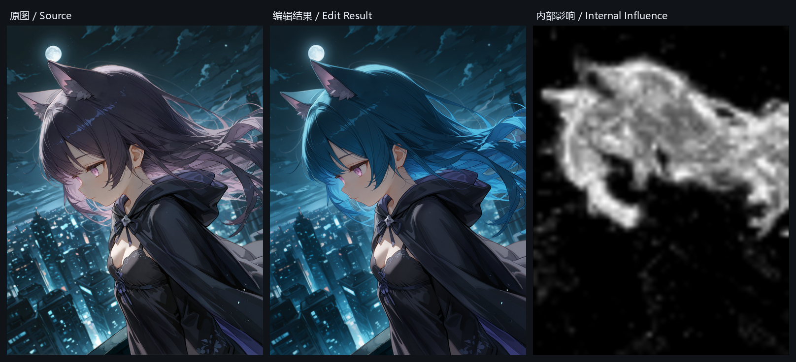

# ComfyUI_KleinAttentionMask

从 FLUX.2 [klein] 9B **模型内部预测**中估计图像编辑的目标区域，输出 MASK。不需要 SAM、GroundingDINO 或任何外部分割模型，也不需要额外填写"要分割什么物体"——只靠编辑指令本身。



> 原图 → 模型内部自动掩码 → 编辑结果（头发改为蓝色）。全程未使用任何分割提示词。

---

## 许可证 / License

本项目采用 **MIT License**，详见 [LICENSE](LICENSE)。

第三方作品与本项目的关系见下方[技术参考与致谢](#技术参考与致谢)。引用请注明出处。

---

## 它解决什么问题

指令式图像编辑模型（Qwen-Image-Edit、Step1X-Edit、FLUX Kontext、Klein 等）本身**不输出"我要改哪里"**。批量跑图时你只有两个选择：

1. **手动画掩码** —— 每张图都要画，批量场景不可行；
2. **外部分割模型**（SAM / GroundingDINO / Florence2 + 提示词）—— 需要为每类编辑目标写提示词，遇到"新增物体""换背景""改材质"就失效，而且分割结果和编辑模型真实意图是两套系统。

本插件走第三条路：**直接问模型自己**。在去噪过程中截取模型的内部预测，量化"这条编辑指令让模型在哪些位置产生了不同的预测"。

---

## 快速开始

### 安装

```bash
cd ComfyUI/custom_nodes
git clone https://github.com/774417678/ComfyUI_KleinAttentionMask.git
```

无第三方 Python 依赖，只用 ComfyUI 自带 PyTorch。重启 ComfyUI 即可。

### 推荐配置

在节点面板搜索 `Klein 内部掩码`，选用任一采样器变体，按下面设置：

| 参数 | 推荐值 |
|---|---|
| `mode` | `sparse_neutral` |
| `capture_start` | `0` |
| `capture_end` | `1` |
| `probe_steps` | `2` |
| `threshold` | `0.20` |
| `grow` | `2` |
| `feather` | `4` |

**这是经过实测验证的默认配置。** 只需在最前两步（噪声最大时）做两次中性配对，就能得到干净的裙子区域掩码，额外开销只有 2 次模型前向。

> ⚠️ `sparse_neutral` 及其余中性模式**必须连接 `clip` 输入**（中性指令要经文本编码器编码）。`source_latent` 和 `adjacent_prediction` 两个零开销模式不需要 CLIP。

可直接导入 [`workflows/01_recommended_sparse_neutral.json`](workflows/01_recommended_sparse_neutral.json)。该工作流的 `LoadImage` 指向 `example_input.png`，请先把 [`images/example_input.png`](images/example_input.png) 复制到 ComfyUI 的 `input/` 目录。模型名请改成你自己的 Klein 9B 权重（模板中为占位名 `klein9b/your_klein_9b.safetensors`），尺寸为 896×1152。

---

## 技术核心

这一节说明它到底在做什么，以及为什么这样做。

### 1. 切入点：ComfyUI 官方的 `model_function_wrapper`

ComfyUI 的 `ModelPatcher` 提供 `set_model_unet_function_wrapper()`，允许在每次 `apply_model` 调用前后插入逻辑。本插件通过这个官方扩展点挂载采集器，**不修改 ComfyUI 核心代码**，也不替换采样器、噪声、sigma 调度——原采样流程由 ComfyUI 原生节点原样执行，采集只是旁路观察。

### 2. 关键：比较「内部去噪预测」，不是「最终输出图像」

每个去噪步，模型输出的其实是对**干净 latent** 的预测（x0-prediction）。本插件的核心操作是：

```
同一份带噪 latent、同一个噪声等级 σ
    ├─ 用「编辑指令」跑一次  → 预测 A
    └─ 用「保持原图不变」跑一次 → 预测 B
差值 = RMS(A - B) 在通道维上聚合 → 空间响应图
```

**为什么不直接对最终两张 RGB 图求差？** 因为 VAE 编解码误差、像素级噪声、JPEG 压缩伪影的量级远大于真实编辑区域，差异会被彻底淹没。而在 latent 预测层面比较，信号干净得多，且天然对齐模型"打算改哪里"。

这个"用同条件下的预测差异定位编辑区域"的思路，沿袭自 [DiffEdit](https://arxiv.org/abs/2210.11427) 与 [Watch Your Steps](https://arxiv.org/abs/2308.08947)（见致谢）。

### 3. 为什么强调「同状态」（same-state）

模型预测同时取决于 **latent 状态**和**噪声等级**。如果把第 0 步的中性预测固定下来，拿去和第 3 步的编辑预测比，差值里会混入"模型逐渐看清图像"这个正常去噪过程的变化——那是去噪，不是编辑指令的影响。

所以 `sparse_neutral` / `dense_neutral` 严格在**同一 latent、同一 σ** 上配对运行。这也是 `fixed_neutral` 模式被标记为"含跨状态差异"的原因：它省掉重复计算，但代价是语义不纯。

### 4. latent 坐标对齐（容易踩的坑）

ComfyUI 的 Flux2 latent 是 **128 通道 packed 表示，空间分辨率是像素的 1/16**。更关键的是：VAE 直接 encode 出来的 latent 和模型内部使用的 latent **不在同一坐标系**——模型内部会做 batch-norm 风格的缩放。

所以原图 latent 必须先经过 `model.model.process_latent_in()` 转换，才能和模型预测比较。跳过这一步，差异图会被 VAE 的 scale/bias 主导，得到毫无意义的掩码。

同理， latent 空间尺寸是 1/16 而非 1/8，掩码上采样必须 ×16。

### 5. 为什么不是直接用注意力

实测中，朴素的注意力总量指标在这个任务上不可靠：

| 指标 | 实测表现 |
|---|---|
| 图像 token 对**文本** token 的注意力总量 | 偏向背景空白区 |
| 图像 token 对**参考图** token 的注意力总量 | 圈出整个人，漏掉部分目标衣物 |

"哪里注意力高"和"编辑指令影响了哪里"不是一回事。指令影响差分直接测量后者，实测对"衣服换色""头发换色"都能正确迁移热区。本仓库保留了两个注意力探针节点（`KleinAttentionMaskProbe` / `KleinAttentionMaskExtract`），但**仅作诊断用途，不建议用于批量**（它们使用全局状态存储，且上述指标不稳健）。

### 6. 取 CFG 之前的原始正向预测

CFG 混合后的输出是 guidance 加权结果，不是模型对正向条件的纯预测。采集器从 `cond_or_uncond` flags 中定位正向分支（flag `0`），在 CFG 混合**之前**取原始预测。负向分支绝不能被误当中性基准——两者语义完全不同。

---

## 节点清单

| 节点 | 采样接口 | 额外前向（默认配置） |
|---|---|---:|
| `KleinMaskSamplerCustomAdvanced` | **NOISE + GUIDER + SAMPLER + SIGMAS + LATENT**（你指定的五输入） | 2 |
| `KleinMaskSamplerCustom` | MODEL / add_noise / noise_seed / cfg / positive / negative / SAMPLER / SIGMAS / LATENT | 2 |
| `KleinMaskKSampler` | 标准 KSampler（含 `denoise`） | 2 |
| `KleinMaskKSamplerAdvanced` | KSamplerAdvanced（含加噪开关、起止步、保留剩余噪声） | 2 |
| `KleinInternalEditMaskSampler` | 旧版单节点（内置 euler/simple/CFG=1） | 2 |
| `KleinAttentionMaskProbe` / `KleinAttentionMaskExtract` | 注意力诊断（**遗留，不推荐**） | 0 |

四个采样器变体的输出前缀为原生输出，之后固定追加 5 个 MASK 类输出：

```
[原生输出...] , edit_mask , influence_heatmap , diagnostics , comparison_masks , comparison_heatmaps
```

---

## 参数详解

### `mode` —— 五种对比基准

| 模式 | 比较对象 | 额外前向 | 含义与适用 |
|---|---|---:|---|
| **`source_latent`** | 每步干净预测 ↔ `process_latent_in(原图 latent)` | **0** | "模型预测会把原图改成什么样"。最快，但包含 VAE 重建漂移和模型自发改动。适合先快速批量筛图 |
| **`fixed_neutral`** | 每步预测 ↔ 第 0 步那次中性预测 | **1** | 只算一次基准。含跨噪声状态差异，语义不纯，但开销极低 |
| **`adjacent_prediction`** | 第 N 步预测 ↔ 第 N-1 步预测 | **0** | "哪里还在变"。已稳定下来的编辑信号会消失，后期纹理抖动反而明显。适合观察采样动态 |
| **`sparse_neutral`** ⭐ | 选定调用的编辑预测 ↔ 同状态中性预测 | = `probe_steps` | **纯净的指令影响**。推荐默认 |
| **`dense_neutral`** | 窗口内每步都配对 | = 窗口内步数 | 最完整，也最慢 |
| **`compare_all`** | 以上五种同时输出 | 各模式之和 | 一次采样对比全部模式，用于调参 |

`compare_all` 的前三个输出采用 `source_latent`，五组完整结果从 `comparison_masks` / `comparison_heatmaps` 读取，顺序固定为：

```
source_latent → fixed_neutral → adjacent_prediction → sparse_neutral → dense_neutral
```

### 采样与掩码参数

| 参数 | 默认 | 说明 |
|---|---|---|
| `threshold` | `0.20` | 热图二值化阈值。热图已归一化到约 0~1，**这是绝对阈值，不是"取最亮的百分之几"**。**调大→选区缩小；调小→选区扩大** |
| `grow` | `2` | 二值掩码向外扩张半径（最终图像像素）。补边用；过大会吃周边 |
| `feather` | `4` | 边缘羽化半径（最终图像像素）。让 `ImageCompositeMasked` 贴回时过渡自然 |
| `probe_steps` | `2` | **仅 `sparse_neutral`**：在采集窗口内均匀选几个调用做中性配对 |
| `capture_start` | `1` | 从第几次**模型调用**开始采集，0 起编号。`0` 表示含第一步 |
| `capture_end` | `-1` | 采集到第几次调用为止；`-1` 表示到结束 |

> ⚠️ **`capture_start` / `capture_end` 计的是「模型调用序号」，不是 scheduler 步号。** Heun、dpmpp_2m、ER-SDE 等算法会在一个 sigma 区间内多次调用模型，调用数会多于步数。自适应算法请填确定的 `capture_end`。`diagnostics` 输出里有真实的调用序号与 σ 列表，可据此核对。

### 可选输入

| 输入 | 何时需要 |
|---|---|
| `clip` | `fixed_neutral` / `sparse_neutral` / `dense_neutral` / `compare_all` **必须接**；`source_latent` / `adjacent_prediction` 不需要 |
| `source_latent` | 默认以 `latent_image["samples"]` 为基准。**若输入是中途续采的带噪 latent，必须显式提供干净原图 latent**，否则基准无意义 |

---

## 推荐配置为什么是 `sparse_neutral` + `0` + `1`

去噪早期的步骤（高噪声）承载最强的**语义定位**信号——模型此时还在决定"改哪里"；到后期预测趋于稳定，差异变小且容易混入纹理级噪声。

只在前两步做配对：
- 信号最强的位置已覆盖；
- 额外前向仅 2 次，4 步采样总开销 4→6；
- 实测「头发改蓝」掩码干净集中在头发，无明显溢出。

需要更高精度时再逐步放宽 `capture_end`；批量筛图追求速度时用 `source_latent`（零额外前向）。

---

## 工作流

| 文件 | 用途 |
|---|---|
| [`workflows/01_recommended_sparse_neutral.json`](workflows/01_recommended_sparse_neutral.json) | 推荐配置，五输入采样器 + 掩码/结果/合成三路输出 |
| [`workflows/02_compare_all_modes.json`](workflows/02_compare_all_modes.json) | 一次采样输出五组掩码与热图，用于对比调参 |
| [`workflows/03_full_example_self_mask.json`](workflows/03_full_example_self_mask.json) | 完整实战示例（原 `klein自遮罩示例工作流`）：自动分辨率 + 原生 `ReferenceLatent` 条件 + 热图二次阈值 + 模糊合成 + 三联对比 |

### 工作流 03 说明

功能更完整的实战图，与 01 的区别：

- **条件路径**用原生 `CLIPTextEncode → ReferenceLatent`（配 `ConditioningZeroOut` 做负向），不依赖 `PainterFluxImageEdit`；
- **分辨率自适应**：`easy imageSize` + `ComfyMathExpression` 按面积把任意原图缩放到约 1MP；
- **掩码消费方式不同**：不直接用 `edit_mask`，而取 `influence_heatmap`（第 4 个输出 `out3`）→ `ThresholdMask 0.06` → `GrowMask 15` → 高斯模糊 → `ImageCompositeMasked`。热图是连续值，低阈值 + 大扩张适合边缘柔和的头发/布料；
- `LoraLoaderModelOnly` 挂编辑一致性 LoRA，**已置为旁路模式**：没有该 LoRA 也能跑，需要时右键启用并换成自己的权重；
- 用 rgthree 的 `Set/Get Node` 做连线复用，`Image Comparer` 做前后对比。

**额外依赖插件**（01/02 不需要）：

| 插件 | 用到的节点 |
|---|---|
| [rgthree-comfy](https://github.com/rgthree/rgthree-comfy) | `SetNode` / `GetNode` / `Image Comparer` / `Any Switch` |
| [ComfyUI-Easy-Use](https://github.com/yolain/ComfyUI-Easy-Use) | `easy imageSize` |
| [ComfyUI_LayerStyle](https://github.com/chflame163/ComfyUI_LayerStyle) | `LayerFilter: GaussianBlur` / `LayerMask: MaskPreview` |
| [ComfyUI-LogicUtils](https://github.com/aria1th/ComfyUI-LogicUtils) | `MaxNode` |

> `SetNode` / `GetNode` / `Image Comparer` / `Any Switch` / `Note` 属**前端虚拟节点**，不会出现在 `/object_info`，查不到是正常的。

该图默认 `sparse_neutral` + `capture_start=0` + `capture_end=1` + `probe_steps=1`。KV 权重（`flux-2-klein-9b-kv-fp8`）与非 KV 权重均实测可用。

01/02 两个工作流的 `LoadImage` 指向 `example_input.png`，使用前请把 [`images/example_input.png`](images/example_input.png) 放进 ComfyUI `input/` 目录，并把 `UNETLoader` 改成你的 Klein 9B 权重。编辑指令写在 `PainterFluxImageEdit` 的 `prompt` 中，示例为「Change the hair to blue. Keep everything else unchanged.」。

掩码的典型用法：`ImageCompositeMasked`，destination = 原图，source = 编辑结果，mask = `edit_mask`。白色区域采用编辑结果，黑色保留原图。

**注意**：掩码是在采样**之后**输出的，用于合成；它不会反过来约束刚才那次采样。若要让掩码局部二次重绘，请把它接到下一遍 inpaint。

---

## 已验证环境

- ComfyUI 0.42.3（V3 节点 API）
- PyTorch 2.13.0+cu130 / Python 3.14.7
- FLUX.2 [klein] 9B（`moodyDesireMixFlux2_v30_pruned_fp8`，FP8，896×1152）
- 编码器 Qwen3-8B fp8mixed + `flux2-vae`

**已验证**：五种模式、batch=2 张量维度、CFG 正负分支乱序、`noise_mask` 传递、原生采样输出不被修改、四种采样器接口真实跑通、三个发布工作流端到端跑通（含「头发改蓝」示例），KV 与非 KV 权重均可用。

**未验证**：batch > 2、视频/nested latent、DualCFG 引导器、ControlNet 条件下的中性重放、多 GPU、第三方量化执行引擎。

---

## 已知限制

1. **实验性区域估计，不是精确语义分割。** 边界可能漏选或包含周边变化。批量无人值守前请先看 `influence_heatmap`。
2. **仅支持 ComfyUI 原生 Flux2 Klein 9B。** 会显式拒绝：已有 `model_function_wrapper` 的模型、DualCFG / 未知引导器、第三方 cond 执行器、nested/video latent、形状不匹配的 source latent。
3. **中性重放不支持 ControlNet。** 节点会显式报错而非静默出错。
4. **模型克隆只隔离 patch/options，不是独立模型副本。** 不宣称并发安全。
5. **`KleinAttentionMaskProbe` / `KleinAttentionMaskExtract` 为遗留诊断节点**，使用全局状态存储，不适合批量或多个探针同时使用。

---

## 技术参考与致谢

本项目受以下工作启发，并明确声明与其的关系：

| 项目 | 关系 |
|---|---|
| [**DiffEdit**](https://arxiv.org/abs/2210.11427)（arXiv:2210.11427） | "用文本条件下的预测差异自动生成编辑掩码"这一核心思想的方法论源头。本项目将同一思想迁移到 DiT 指令编辑器的 latent 预测层 |
| [**Watch Your Steps**](https://arxiv.org/abs/2308.08947)（ECCV 2024，[代码](https://github.com/SamsungLabs/WatchYourSteps)） | 用「有/无编辑指令的模型预测差异」定位编辑区域。本项目的 same-state 配对设计直接受此启发 |
| [**TAL: Rethinking Where to Edit**](https://arxiv.org/abs/2604.20258)（ACM MM 2026，[代码](https://github.com/Jessie459/TAL)) | 面向 DiT 指令编辑器的编辑定位研究，启发了本项目的动机。**本项目不是 TAL 的复现**——TAL 走"注意力 + 特征质心 + 任务相关掩码构造"路线，本项目走"内部预测差分"路线，两者方法与实现均不同 |
| [**ComfyUI**](https://github.com/comfyanonymous/ComfyUI) | 提供 `model_function_wrapper`、`SamplerCustomAdvanced` 等官方扩展点与原生采样实现，本项目全部逻辑为旁路挂载 |
| [**FLUX.2 [klein]**](https://github.com/black-forest-labs/flux2) | Black Forest Labs 的开源权重与推理代码，本项目的目标模型家族 |

未使用上述任何项目的代码；引用仅为学术脉络说明。

---

## 目录结构

```
ComfyUI_KleinAttentionMask/
├── __init__.py                 节点注册
├── sampler_variants.py         四种采样器变体 + 采集器
├── internal_sampler.py         旧版单节点 + 五种模式核心逻辑
├── mask_node.py                旧版注意力探针节点
├── probe.py                    旧版注意力探针采集器
├── docs/
│   ├── USAGE_ZH.md             旧版节点使用说明
│   └── SAMPLER_VARIANTS_ZH.md  采样器变体详细说明
├── workflows/
│   ├── 01_recommended_sparse_neutral.json
│   ├── 02_compare_all_modes.json
│   └── 03_full_example_self_mask.json
└── images/
    ├── example_input.png       工作流所需输入图（896×1152）
    ├── demo_overview.png       三联演示图
    ├── demo_edit.png           编辑结果
    └── demo_influence.png      内部影响热图
```

示例图片为原创绘制的动漫风格角色，可自由使用。
